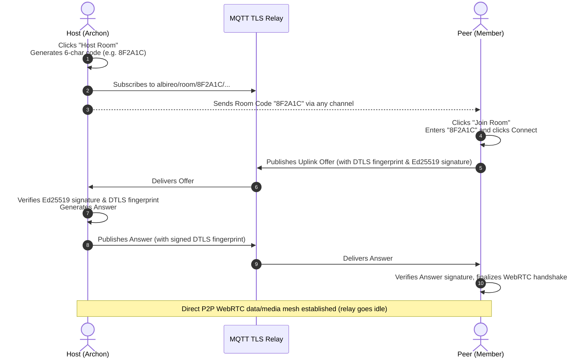

# 🌌 Albireo

<div align="center">


<br/>

<h3>Next-Gen Serverless · Zero-Trust E2EE · Decentralized WebRTC Mesh Communication Engine</h3>

<p align="center">
  <b>English</b> • <a href="README_zh.md">简体中文</a>
</p>

<p align="center">
  <b>Albireo</b> is an enterprise-grade, serverless Peer-to-Peer (P2P) unified communications platform designed for high-security enclaves, distributed teams, and decentralized autonomous organizations.<br/>
  Operating with <b>zero reliance on centralized application servers or third-party cloud databases</b>, Albireo combines a resilient WebRTC Mesh architecture with <b>Ed25519 zero-trust identity signing</b>, <b>X25519 Diffie-Hellman room key distribution</b>, <b>DTLS certificate fingerprint binding</b>, <b>Smart VAD 2.0 noise gate</b>, <b>15-second ghost session resumption</b>, and an <b>automated democratic succession governance model</b>.
</p>

[✨ Key Features](#-key-features) • [🏗️ Architecture](#%EF%B8%8F-system-architecture) • [📦 Installation](#-installation--prerequisites) • [📖 User Manual](#-comprehensive-user-manual) • [⚙️ Configuration](#%EF%B8%8F-configuration-reference-settingsjson) • [❓ FAQ](#-troubleshooting--faq) • [🧪 Testing & Dev](#-automated-testing--extensibility)

</div>

---

## ✨ Key Features

### 🛡️ End-to-End Cryptographic Security (Zero-Trust & E2EE)
- **Sovereign Cryptographic Identity**: Every node generates an **Ed25519** asymmetric keypair on startup. The public key fingerprint serves as the peer's globally unique, tamper-proof network identity.
- **Full-Spectrum Payload Signing**: Every single application-layer packet—chat messages, file metadata/chunks, governance votes, and node heartbeats—is cryptographically signed with the sender's private key. Forged or modified packets are dropped immediately at the gateway layer.
- **Diffie-Hellman Room Key Exchange (E2EE)**: Ed25519 keys automatically convert to **X25519** curve keys. The room Archon encrypts symmetric session keys (`SecretBox`) using asymmetric `nacl.public.Box` pairwise encryption, guaranteeing mathematical privacy across untrusted relays.
- **DTLS Certificate Fingerprint Binding**: During SDP negotiation, the WebRTC DTLS certificate fingerprint (`a=fingerprint:`) is extracted and cryptographically anchored to the sender's Ed25519 identity. The receiving node strictly validates the signature against the actual DTLS fingerprint, **mathematically eliminating nation-state Man-in-the-Middle (MITM) certificate spoofing attacks**.

### 🎙️ Audio/Video Engine & Smart DSP
- **Smart VAD & Noise Gate 2.0**:
  - **Dual-Threshold Hysteresis**: Uses an Attack Threshold of `450.0 RMS` and a Release Threshold of `220.0 RMS`, preventing jittery mic toggling around sensitivity boundaries.
  - **300ms Hangover Tail Preservation**: Holds the voice gate open for 15 PCM frames (300ms) after speech drops below the release threshold. This preserves natural consonant endings and conversational breathing while silencing pure background noise.
- **Real-Time Dynamic Audio Visualizer Canvas**:
  - The top navigation bar houses an 8-bar dynamic spectrum visualizer powered by a custom Lerp damping algorithm (rise rate: `0.45`, decay rate: `0.15`), giving the interface an organic, cyberpunk pulse.
- **Global Audio Mixer**:
  - Multi-peer raw PCM audio mixing with adaptive Jitter Buffering, dynamic software gain control, channel downmixing, and low-latency Windows WASAPI stereo output.
  - One-click toggling between **Push-to-Talk (PTT)** and **Open Mic** modes with real-time VU-level feedback.
- **Adaptive High-Framerate Screen Sharing**:
  - Low-latency screen capture via MSS, dynamic resolution scaling, and SFU/MCU canvas compositing.

### 🌐 Resilient Mesh & Disaster Recovery
- **Dual-Mode Signaling Fabric**:
  - **One-Click Pairing (MQTT TLS Relay)**: Share an ephemeral **6-character room code** to establish instant peer connections across the internet via lightweight, TLS-encrypted MQTT coordination.
  - **Air-Gapped Out-of-Band Signaling**: Uses Zlib compression + Base64 encoding to produce ultra-compact SDP strings, enabling air-gapped manual handshakes over Signal, Telegram, offline local networks, or QR codes.
- **15-Second Ghost Grace Period (Session Resumption)**:
  - If a peer experiences transient Wi-Fi drops or momentary packet loss, the connection transitions into a 15-second "ghost" grace period instead of immediately dropping the peer. The UI displays a `[RECONNECTING...]` badge with an amber border. If the connection recovers within 15 seconds, the session seamlessly resumes.
- **Symmetric NAT Relay Fallback**:
  - Full STUN/TURN integration with an optional `force_relay` policy and SDP candidate filtering, guaranteeing reliable connections across strict corporate firewalls and symmetric NATs.

### 🏛️ Decentralized Governance & Democratic Succession
- **Archon Mode (Central Authority)**: The room creator acts as the Archon, holding exclusive administrative rights to appoint heirs, kick disruptive peers, revoke screen sharing privileges, or disband the mesh.
- **Democracy Mode (Consensus Dismissal)**: Any peer can initiate a cryptographically signed Vote Kick against a malicious actor. When consensus reaches 50%, all nodes simultaneously ban and sever connections with that peer.
- **Automated Succession Protocol**:
  - If the Archon disconnects, governance authority transfers smoothly to the designated Heir.
  - If no heir exists, the mesh triggers a deterministic, serverless multi-round election algorithm. Ties are resolved via public-key hash sortition, ensuring global consensus without centralized coordination.

### 🌌 Galaxy Deep Space Aesthetics
- Modern dark-mode interface built on deep astrophysics colorways: Cosmos Abyss (`#070913`), Nebula Slate (`#0F1426`), Starlight Cyan (`#38BDF8`), Emerald Aurora (`#10B981`), and Supernova Violet (`#A855F7`).
- Implemented with a **Redux/Flux Unidirectional Architecture** (Store, Action, Reducer), completely decoupling views (`MemberView`, `TopBarView`, `ChatView`, `VideoView`) to eliminate UI stutter and state desynchronization.

---

## 🏗️ System Architecture

```text
┌─────────────────────────────────────────────────────────────────────────────┐
│                       CustomTkinter UI (Galaxy Theme)                       │
│  [TopBar + Visualizer]  [Member Grid & Gov]  [Video Canvas]  [Chat Stream]  │
└──────────────────────────────────────┬──────────────────────────────────────┘
                                       │ Dispatch Actions / Listen State
┌──────────────────────────────────────▼──────────────────────────────────────┐
│                    Redux / Store (Unidirectional Data Flow)                 │
│         [MEMBERS] [AUDIO_LEVEL] [GOVERNANCE] [E2EE_KEY] [GHOST_STATE]       │
└──────────────────────────────────────┬──────────────────────────────────────┘
                                       │ Injected Facade API
┌──────────────────────────────────────▼──────────────────────────────────────┐
│                         CoreAPI (Gateway Facade)                            │
│    ├── MessageRouter (Topic Routing & Deduplication)                        │
│    ├── TopologyManager (Heartbeat & Mesh Gossip Discovery)                  │
│    └── MigrationCoordinator (Consensus Succession & Elections)              │
└───────────────┬─────────────────────────────────────────────┬───────────────┘
                │ Cryptographic Operations                    │ Signaling & WebRTC
┌───────────────▼───────────────┐             ┌───────────────▼───────────────┐
│         CryptoManager         │             │         WebRTCEngine          │
│  • Ed25519 Identity Keypair   │             │  • PeerConnection Pool        │
│  • X25519 Diffie-Hellman Key  │             │  • 15s Ghost Grace Resumption │
│  • E2EE Symmetric SecretBox   │             │  • TURN Candidate Filter      │
│  • DTLS Fingerprint Binding   │             │  • SFU / MCU Video Compositor │
└───────────────────────────────┘             └───────────────┬───────────────┘
                                                              │
                              ┌───────────────────────────────┴───────────────┐
                              │                 Network Fabric                │
                              │  [MQTT TLS Broker]  [Direct P2P]  [TURN Relay]│
                              └───────────────────────────────────────────────┘
```

---

## 📦 Installation & Prerequisites

### 1. Requirements
- **Operating System**: Windows 10/11 (recommended for native WASAPI support), Linux, or macOS.
- **Python**: Version `3.10` or newer.
- **Environment Manager**: Miniconda or `venv` is recommended.

### 2. Clone & Create Environment
```bash
# 1. Clone the repository
git clone https://github.com/haku-zero/p2p_voice_albireo.git
cd p2p_voice_albireo

# 2. Create and activate a Python 3.10 environment
conda create -n p2p python=3.10 -y
conda activate p2p
```

### 3. Install Dependencies
```bash
# 3. Install required packages
pip install -r requirements.txt
```

> [!TIP]
> **Windows PyAudio Installation Note**:
> If compiling `pyaudio` fails due to missing C++ build tools, install via a precompiled wheel:
> ```bash
> pip install pipwin
> pipwin install pyaudio
> ```
> **Linux Installation Note**:
> Ensure underlying ALSA and PortAudio development libraries are installed first:
> `sudo apt-get install portaudio19-dev python3-pyaudio libasound-dev`

---

## 📖 Comprehensive User Manual

### Mode 1: 6-Character Room Code Pairing (Recommended)

This is the simplest connection mode, using an ephemeral encrypted MQTT coordination channel for instant SDP exchange:



1. **Host a Room**:
   - Launch the application: `python main.py`.
   - Enter your Callsign (e.g., `Commander`), and click **Host Room**.
   - A modal displays a **6-character Room Code** (e.g., `4E9B2F`). Click **Copy Code** to copy it.
2. **Join the Room**:
   - The peer launches `python main.py`.
   - Enters their Callsign (e.g., `Operator`), and clicks **Join Room**.
   - Pastes the 6-character code into the dialog and clicks **Connect**.
3. **Connection Established**:
   - Within 1–3 seconds, the background handshake verifies DTLS fingerprints, performs ICE gathering, and connects.
   - The member list displays green connection indicators. Voice, screen sharing, and chat are active!

---

### Mode 2: Air-Gapped Manual Handshake (Zero-Network / Classified Enclaves)

In isolated local networks without access to external MQTT brokers, Albireo supports manual SDP handshakes:

1. **Host Generates Offer**:
   - Click **Manual Mode (Air-Gapped)**.
   - Click **Generate Uplink Offer**. Albireo compresses the local WebRTC parameters, DTLS fingerprint, and Ed25519 signature into a Base64 string.
   - Click **Copy Offer** and send it to your peer (via local chat, flash drive, or QR code).
2. **Peer Imports Offer & Generates Answer**:
   - The peer opens **Manual Mode**, pastes the Offer string into the input box, and clicks **Accept Offer & Generate Answer**.
   - The system verifies the cryptographic signature, binds the fingerprint, and generates an Answer string.
   - Send this Answer string back to the host.
3. **Host Finalizes Connection**:
   - The host pastes the Answer into the **Apply Answer** dialog and confirms.
   - The P2P mesh connection initializes immediately!

---

### Mode 3: Headless SFU Daemon (Server Relay)

To deploy an always-on relay node or media anchor on a Linux server, Raspberry Pi, or NAS:

```bash
# Run headless in the specified room
python main.py --headless --room 8F2A1C
```
- Operates without Tkinter GUI dependencies as a lightweight `asyncio` daemon.
- Coordinates in-room mesh routing, video compositing, and network persistence.

---

### Mode 4: Interactive CLI Terminal Client

For SSH sessions, headless environments, or terminal lovers:

```bash
# Start the interactive console
python main.py --cli

# Or launch directly with room code and callsign
python main.py --cli --room 8F2A1C --callsign Commander
```

Supported interactive commands:
- `/join <room_code>`: Join an existing room (auto-syncs chat history from Host)
- `/host [room_code]`: Host a new room (`archon` or `democracy` mode)
- `/say <message>` (or type text directly): Broadcast an E2EE encrypted message
- `/history [n|all]` or `/chats`: Display chat history (formatted with timestamps `[HH:MM:SS]` and sender tags)
- `/last` or `/latest`: Show the most recent message received or sent and relative elapsed time
- `/sync`: Manually request full chat history re-sync from room host
- `/members` or `/who`: List connected peers and callsigns
- `/status`: Inspect public key identity, room info, and network state
- `/kick <peer_id>` / `/ban <peer_id>`: Initiate vote-kick or archon ban
- `/vote <peer_id> <yes|no>`: Vote on an active kick proposal
- `/heir <peer_id>`: Designate an heir for governance succession
- `/clear [history]`: Clear console screen or wipe local chat history (`/clear history`)
- `/leave`: Disconnect and leave current room
- `/quit` or `/exit`: Exit the CLI client

> [!TIP]
> **Dynamic Latest Message Banner**: The interactive CLI prompt continuously reflects the most recent message across the room: `[📌 最新消息: HH:MM:SS Callsign]: Message preview`. When a new message arrives from any node, the prompt live-refreshes to keep you informed.

---

### 🎮 Interface Controls & Interactions

#### 1. Audio Controls & Visualizer
- **Mode Switching**:
  - **Open Mic**: Activates Smart VAD 2.0. Speech transmission triggers automatically when voice energy exceeds the threshold, with a 300ms natural tail buffer.
  - **Push-to-Talk (PTT)**: Transmission activates only while pressing your designated hotkey (Spacebar by default).
- **Audio Visualizer**: Observe the 8-bar spectrum visualizer in the top navigation bar while speaking. If the bars remain static, ensure the correct input microphone is selected in the **In:** dropdown.

#### 2. Screen Sharing
- Click **Share Screen** in the top bar to broadcast your screen.
- Peers view the broadcast in the primary central viewing canvas with automated aspect-ratio fitting.
- Click **Stop Sharing** to terminate screen broadcasting.

#### 3. Decentralized Peer Governance (Right-Click Context Menu)
**Right-click any peer card** in the left sidebar to access governance actions:

| Action | Required Role | Description |
| :--- | :--- | :--- |
| **👑 Appoint as Heir** | Archon | Designates this peer as the official successor. Authority transfers to them instantly if the Archon disconnects. |
| **🚫 Kick Member** | Archon | Immediately severs connections with this peer and broadcasts a network-wide eviction directive. |
| **🗳️ Initiate Vote Kick** | All Members | Initiates a democratic impeachment vote. If 50% or more of the mesh votes in favor, the target peer is banished. |
| **🖥️ Toggle Screen Share** | Archon | Grants or revokes permission for that node to broadcast screen video across the mesh. |

---

## ⚙️ Configuration Reference (`settings.json`)

On its first launch, Albireo generates a `settings.json` file in the application directory:

```json
{
    "local_id": "zero",
    "callsign": "Commander",
    "in_device": "Default",
    "out_device": "Default",
    "mic_vol": 1.0,
    "mic_mode": "OPEN_MIC_MODE",
    "speaker_vol": 0.1,
    "private_key": "07285df5351b7f2010be0d108c8c0f51ddaf56375b51112fc26304c288d31f5c",
    "mqtt_broker": "broker.emqx.io",
    "mqtt_port": 8883,
    "mqtt_use_tls": true,
    "force_relay": false,
    "ice_servers": [
        { "urls": ["stun:stun.l.google.com:19302"] },
        { "urls": ["stun:global.stun.twilio.com:3478"] }
    ]
}
```

### Parameter Details

| Key | Type | Description |
| :--- | :--- | :--- |
| `private_key` | `string` | **Hex-encoded Ed25519 private key**. Never share this key. Deleting this key will cause a new cryptographic identity to generate on the next launch. |
| `force_relay` | `boolean` | **Enforce TURN relay fallback**. Set to `true` when operating behind strict enterprise symmetric NATs to route traffic through TURN relays. |
| `ice_servers` | `array` | List of STUN and TURN server definitions. |
| `mqtt_broker` | `string` | MQTT broker endpoint used for automated signaling (e.g., `broker.emqx.io` or an internal `mosquitto` server). |
| `mqtt_port` | `integer` | MQTT port (`8883` for TLS). |
| `mic_mode` | `string` | Voice transmission mode (`OPEN_MIC_MODE` or `PTT_MODE`). |

> [!TIP]
> **Configuring a Self-Hosted Coturn Server**:
> Open the Network Settings dialog and click **Load TURN Template**, or update `ice_servers` directly:
> ```json
> [
>     { "urls": ["stun:stun.your-domain.com:3478"] },
>     {
>         "urls": ["turn:turn.your-domain.com:3478?transport=udp", "turn:turn.your-domain.com:3478?transport=tcp"],
>         "username": "your_username",
>         "credential": "your_secure_password"
>     }
> ]
> ```

---

## ❓ Troubleshooting & FAQ

### Q1: Both users entered the correct Room Code, but the connection times out.
- **Cause**: Both peers are likely behind **Symmetric NATs** or strict enterprise firewalls that prohibit direct UDP hole punching.
- **Resolution**:
  1. Open the **NAT Traversal & Relay Settings** dialog.
  2. Toggle **Force TURN Relay Only (Bypass Symmetric NAT)** to on.
  3. Ensure a valid TURN server configuration is saved under ICE servers.
  4. Restart the app and reconnect; traffic will route through the TURN relay.

### Q2: My microphone is connected, but peers cannot hear me.
- **Diagnostics**:
  1. Check the top navigation bar's **8-bar Audio Visualizer**: If the bars do not react while speaking, the application is not receiving audio from your microphone.
  2. In the **In:** device dropdown, select the specific physical hardware device (e.g., Realtek Audio or USB Headset) instead of "Default".
  3. Verify OS microphone permissions (Windows Settings -> Privacy & Security -> Microphone -> Allow desktop apps).
  4. Ensure you are not in `PTT` mode without pressing the transmission key.

### Q3: Is traffic safe from eavesdropping when routed through a TURN server?
- **Yes, unconditionally**. Albireo implements a mathematical **Zero-Trust** model:
  - Audio and video are encrypted using standard **DTLS-SRTP**.
  - Signaling payloads bind the DTLS fingerprint to the sender's **Ed25519 identity**, preventing relay servers from executing MITM attacks.
  - Text chat and file transfers receive an extra layer of **X25519 symmetric encryption (`SecretBox`)**.
  - The TURN server sees only encrypted UDP streams, leaving it **mathematically incapable of decrypting user traffic**.

---

## 🧪 Automated Testing & Extensibility

Albireo maintains an end-to-end unit test suite covering signaling, cryptography, UI decoupling, and audio DSP:

### Run Full Test Suite
```bash
python tests/run_tests.py
```
Expected output:
```text
Ran 23 tests in 26.027s
OK
```

### Run Isolated Test Modules
```bash
# Verify DTLS fingerprint binding and anti-tampering protection
python -m unittest tests/test_signaling.py

# Verify Smart VAD 2.0 hysteresis, 300ms hangover, and relay candidate filtering
python -m unittest tests/test_nextgen_features.py

# Verify Ed25519 cryptographic signing and spoof prevention
python -m unittest tests/test_crypto.py
```

### Developing New Services
Adding custom capabilities (such as shared whiteboard collaboration or remote shells) is straightforward via the **`CoreAPI` Facade**:
1. Create a service module under `services/` (e.g., `services/whiteboard/`).
2. Inject `CoreAPI` into your service constructor.
3. Call `core_api.register_message_handler("whiteboard", handler)` to receive peer messages.
4. Call `core_api.broadcast_message({"type": "whiteboard", "data": ...})` to dispatch signed messages across the mesh.

---

## 📄 License

Albireo is distributed under the [MIT License](LICENSE). Contributions, bug reports, and pull requests are warmly welcomed!
