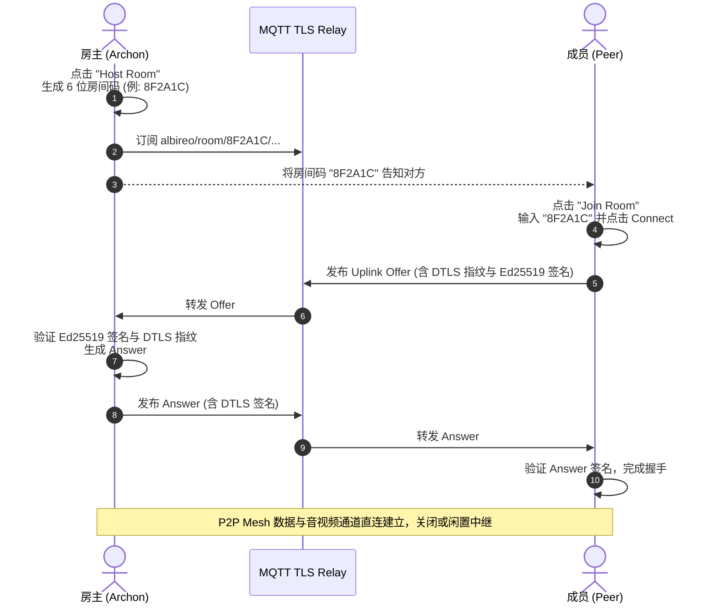

# 🌌 Albireo (辇道增七)

<div align="center">


<br/>

<h3>次世代无中心化 · 零信任端到端加密 · 分布式网状对等通信系统</h3>

<p align="center">
  <a href="README.md">English</a> • <b>简体中文</b>
</p>

<p align="center">
  <b>Albireo</b> 是一款面向企业高敏通信、极客协作与去中心化自治场景设计的全功能 Peer-to-Peer (P2P) 统一通信平台。<br/>
  系统<b>不依赖任何中心化业务服务器与第三方数据存储</b>，基于 WebRTC Mesh 网状拓扑构建，全链路融合 <b>Ed25519 零信任身份签名</b>、<b>X25519 房间密钥交换</b>、<b>DTLS 证书指纹绑定</b>、<b>Smart VAD 2.0 智能降噪</b>、<b>15s 幽灵态容灾自愈</b>与<b>全自动权力继承治理</b>。
</p>

[✨ 核心特性](#-核心特性全景) • [🏗️ 架构设计](#-系统架构) • [📦 环境安装](#-环境安装与依赖配置) • [📖 使用手册](#-完整操作使用手册) • [⚙️ 高级配置](#%EF%B8%8F-配置项详解-settingsjson) • [❓ FAQ](#-常见问题排查与-faq) • [🧪 测试与开发](#-自动化测试与扩展开发)

</div>

---

## ✨ 核心特性全景

### 🛡️ 终极闭环安全体系 (Zero-Trust Cryptography & E2EE)
- **自主可控公私钥体系**：节点本地原生生成并持久化 **Ed25519** 密钥对，公钥哈希直接作为全网唯一不可伪造的数字身份。
- **全链路载荷数字签名**：所有应用层数据包（文本聊天、文件元数据与传输块、治理指令、成员心跳）均经由私钥强签名，由网关在收到第一时间比对验签；伪造或中间人篡改数据包会被底层即刻静默丢弃。
- **Diffie-Hellman 房间密钥分发 (E2EE)**：自动将 Ed25519 转换为 **X25519** 椭圆曲线密钥，执政官使用 `nacl.public.Box` 非对称加密端到端分发房间对称密钥（`SecretBox`），确保跨中继甚至不信任网络环境下的绝对私密性。
- **DTLS 证书指纹深度锚定 (Fingerprint Binding)**：在手动与自动信令交互阶段，提取 SDP 底层 DTLS-SRTP 证书指纹（`a=fingerprint:`）并由发送方 Ed25519 私钥联合签署。接收方强校验签名与指纹一致性，**从数学上彻底根除国家级信令中间人替换证书实施嗅探监听的可能**。

### 🎙️ 极致音画与智能处理引擎 (Audio/Video & Smart DSP)
- **智能语音活动检测 (Smart VAD & Noise Gate 2.0)**：
  - **双门限迟滞机制 (Hysteresis)**：起控阈值 `450.0 RMS`，释音阈值 `220.0 RMS`，彻底杜绝麦克风临界灵敏度下的高频快速开闭（抖动颤音）。
  - **300ms 自然音尾保持器 (Hangover Time)**：在声音落入释音阈值后持续缓冲 15 个 PCM 帧（300ms），完整保留辅音尾音与自然换气，消除机械切断感；真正静音期切断为纯零字节推流，节省网络带宽。
- **实时音频动态波形律动图 (Audio Visualizer Canvas)**：
  - 顶部控制栏内置 8 柱动态频谱可视化画布，基于 Lerp 缓动阻尼算法（上升跟踪系数 `0.45`、平滑衰减系数 `0.15`），赋予界面深邃赛博朋克的自然呼吸感。
- **全局音频混音器 (Global Audio Mixer)**：
  - 多路原始 PCM 混音，集成自适应抖动缓冲（Jitter Buffer）、软音量动态增益控制与 Windows WASAPI 立体声保真输出。
  - 支持 **按住说话 (PTT, Push-To-Talk)** 与 **自由麦 (Open Mic)** 双模式瞬间切换，实时音量监听仪表盘。
- **高画质自适应屏幕共享**：
  - 基于 MSS 超低延迟屏幕抓取，自适应分辨率动态缩放，支持 SFU/MCU 多路画布混流合成与广播观看。

### 🌐 弹性网状拓扑与容灾恢复 (Resilient Mesh & NAT Traversal)
- **双模自愈信令网络 (Dual-Signaling Mode)**：
  - **极简一键连接 (MQTT Relay Signaling)**：内建 TLS 加密 MQTT 随机信令通道，只需分享 **6 位房间码** 即可在几秒内实现全自动对等连接。
  - **纯气隙/离线手动信令 (Air-Gapped Out-of-Band)**：使用 Zlib 压缩 + Base64 编码，生成极其精简的 SDP 字符串，可在完全无公网甚至物理隔离专网下通过即时通讯软件或二维码完成手工握手。
- **15秒幽灵态断线重连 (Session Resumption / Ghost Grace Period)**：
  - 针对 Wi-Fi 抖动、基站切换或网络瞬断，连接断开后进入 15 秒「幽灵缓冲期」。节点显示 `[RECONNECTING...]` 提示并闪烁警告黄色边框；15 秒内网络自愈则无缝恢复会话，避免误踢正常成员。
- **严格对称 NAT 智能中继降级策略 (TURN Relay Fallback)**：
  - 全面支持 STUN/TURN 自定义配置，集成 `force_relay` 模式与 SDP 候选过滤算法，强制剔除直连候选以中继模式穿透企业级严格对称网络与双内网防火墙。

### 🏛️ 去中心化自治治理系统 (Decentralized Governance & Democratic Succession)
- **执政官模式 (Archon Mode)**：房间发起人担任执政官，拥有指定储君、驱逐节点、一键解散网络与屏幕共享权限管控能力。
- **民主弹劾模式 (Democracy Mode)**：任意节点可对异常节点发起加密弹劾投票（Vote Kick），当有效投票率达到 50% 共识门槛，全网节点将自动协同断开该节点并加入黑名单。
- **全自动无缝权力继承 (Automated Succession)**：
  - 若执政官突然离线，网络将在心跳超时后自动将权力平滑移交给指定储君（Heir）。
  - 若无储君，全网节点自动发起确定性多轮无中心选举算法；若出现平票，基于各节点公钥哈希实施确定性抽签，**100% 保证无需任何中央服务器即可达成全球一致的权力更迭**。

### 🌌 银河星空美学设计 (Galaxy Deep Space Aesthetics)
- 遵循严苛的现代深色设计哲学，界面以深空宇宙暗黑（`#070913`）、星云面板（`#0F1426`）为底色，点缀星辉冰蓝（`#38BDF8`）、极光绿（`#10B981`）、超新星紫（`#A855F7`）与告警珊瑚红（`#EF4444`）。
- 全面引入 **Redux/Flux 单向数据流架构**（Store、Action、Reducer），视图层（MemberView、TopBarView、ChatView、VideoView）高度解耦，杜绝界面卡顿与状态不一致。

---

## 🏗️ 系统架构

```text
┌─────────────────────────────────────────────────────────────────────────────┐
│                       CustomTkinter UI (Galaxy Theme)                       │
│  [TopBar + Visualizer]  [Member Grid & Gov]  [Video Canvas]  [Chat Stream]  │
└──────────────────────────────────────┬──────────────────────────────────────┘
                                       │ Dispatch Actions / Listen State
┌──────────────────────────────────────▼──────────────────────────────────────┐
│                    Redux / Store (Unidirectional Data Flow)                 │
│         [MEMBERS] [AUDIO_LEVEL] [GOVERNANCE] [E2EE_KEY] [GHOST_STATE]       │
└──────────────────────────────────────┬──────────────────────────────────────┘
                                       │ Injected Facade API
┌──────────────────────────────────────▼──────────────────────────────────────┐
│                         CoreAPI (Gateway Facade)                            │
│    ├── MessageRouter (Topic Routing & Deduplication)                        │
│    ├── TopologyManager (Heartbeat & Mesh Gossip Discovery)                  │
│    └── MigrationCoordinator (Consensus Succession & Elections)              │
└───────────────┬─────────────────────────────────────────────┬───────────────┘
                │ Cryptographic Operations                    │ Signaling & WebRTC
┌───────────────▼───────────────┐             ┌───────────────▼───────────────┐
│         CryptoManager         │             │         WebRTCEngine          │
│  • Ed25519 Identity Keypair   │             │  • PeerConnection Pool        │
│  • X25519 Diffie-Hellman Key  │             │  • 15s Ghost Grace Resumption │
│  • E2EE Symmetric SecretBox   │             │  • TURN Candidate Filter      │
│  • DTLS Fingerprint Binding   │             │  • SFU / MCU Video Compositor │
└───────────────────────────────┘             └───────────────┬───────────────┘
                                                              │
                              ┌───────────────────────────────┴───────────────┐
                              │                 Network Fabric                │
                              │  [MQTT TLS Broker]  [Direct P2P]  [TURN Relay]│
                              └───────────────────────────────────────────────┘
```

---

## 📦 环境安装与依赖配置

### 1. 系统要求
- **操作系统**：Windows 10/11（推荐，具备 WASAPI 高性能音频驱动支持）、Linux、macOS。
- **Python 版本**：`Python 3.10` 或更高版本。
- **包管理器**：推荐使用 `Miniconda` 或 `venv` 进行虚拟环境管理。

### 2. 克隆项目与创建环境
```bash
# 1. 克隆代码仓库
git clone https://github.com/haku-zero/p2p_voice_albireo.git
cd p2p_voice_albireo

# 2. 创建并激活 Python 3.10 虚拟环境 (以 Conda 为例)
conda create -n p2p python=3.10 -y
conda activate p2p
```

### 3. 安装依赖库
```bash
# 3. 安装项目全部依赖组件
pip install -r requirements.txt
```

> [!TIP]
> **Windows 用户 PyAudio 安装特别提示**：
> 如果 `pip install pyaudio` 报错，通常是由于缺少 C++ 构建工具引起。你可以直接使用预编译 wheel 文件安装：
> ```bash
> pip install pipwin
> pipwin install pyaudio
> ```
> **Linux 用户特别提示**：
> 需要先安装底层音频库：`sudo apt-get install portaudio19-dev python3-pyaudio libasound-dev`。

---

## 📖 完整操作使用手册

### 模式一：通过 6 位房间码一键连接 (推荐 · 最省心)

这是日常使用中最推荐的连接方式，利用内建加密通道瞬间完成 P2P 匹配握手：



1. **房主创建房间**：
   - 运行程序：`python main.py`。
   - 输入你的呼号（Callsign，例如 `Commander`），点击 **Host Room**。
   - 界面弹窗将显示一个醒目的 **6 位房间码**（如 `4E9B2F`），点击 **Copy Code** 复制。
2. **成员加入房间**：
   - 成员运行程序：`python main.py`。
   - 输入呼号（例如 `Operator`），点击 **Join Room**。
   - 在弹出的输入框中粘贴该 6 位房间码，点击 **Connect**。
3. **完成连接**：
   - 系统将在 1~3 秒内全自动通过后台加密信令通道完成 SDP 协商、DTLS 证书指纹校验和 P2P 打洞。
   - 成员列表将亮起绿灯，即可开始高保真语音、屏幕共享与即时文本通信！

---

### 模式二：纯离线气隙级手动连接 (绝密专网 / 无公网环境)

如果在完全物理隔离的内网、无 MQTT Broker 的网络环境下，Albireo 支持纯手工信令交换：

1. **房主就绪**：
   - 点击 **Manual Mode (Air-Gapped)**。
   - 点击 **Generate Uplink Offer**，程序会自动提取本机的 WebRTC 参数、DTLS 证书指纹并结合 Ed25519 私钥生成一段经过 Zlib 压缩的高强度 Base64 文本。
   - 点击 **Copy Offer** 发送给对端（通过内网邮件、聊天工具、U盘甚至是二维码扫描）。
2. **成员导入 Offer 并生成 Answer**：
   - 成员打开 Manual Mode，将收到的 Offer 字符串粘贴到输入框中，点击 **Accept Offer & Generate Answer**。
   - 系统验证公钥指纹后，计算并生成对等的 Answer Base64 字符串。
   - 成员将 Answer 发回给房主。
3. **房主完成握手**：
   - 房主将 Answer 粘贴至界面的 **Apply Answer** 栏并确认。
   - 双方底层 WebRTC 状态机瞬间同步，P2P 通道立刻握手成功！

---

### 模式三：无界面服务端模式 (Headless SFU / Relay Daemon)

如果你希望在云服务器、树莓派或内网 NAS 上作为常驻音视频中继或锚点运行，可以使用 Headless 模式：

```bash
# 在 Linux / Windows 服务器端常驻运行指定房间
python main.py --headless --room 8F2A1C
```
- 该模式下不会加载任何 GUI 依赖和 Tkinter 线程，完全以低内存消耗的 asyncio 守护进程运行。
- 自动负责房间各节点的信令中继、SFU 画布计算与持久保活。

---

### 模式四：交互式终端命令行模式 (Interactive CLI Terminal)

如果你希望在纯 SSH、无显示器 Linux/Windows 终端或极客控制台环境下使用 Albireo，可以使用全新推出的交互式 CLI 终端：

```bash
# 启动交互式控制台
python main.py --cli

# 或直接指定房间号与呼号启动
python main.py --cli --room 8F2A1C --callsign Commander
```

在终端中支持以下交互式斜杠指令：
- `/join <room_code>`：加入指定房间（自动同步房主历史消息）
- `/host [room_code]`：主持创建新房间（可选 `archon` 或 `democracy` 模式）
- `/say <message>` 或直接输入文本：发送端到端（E2EE）加密聊天消息
- `/history [n|all]` 或 `/chats`：查看本地 SQLite 聊天历史记录（带时间戳 `[HH:MM:SS]` 与身份标注）
- `/last` 或 `/latest`：查看全网最新一条接收或发送的消息及相对时间
- `/sync`：主动向房主请求全量重新同步聊天室历史记录
- `/members` 或 `/who`：列出房间内所有已连接的对等节点与呼号
- `/status`：查看当前节点的公钥指纹、呼号、房间状态与网络拓扑
- `/kick <peer_id>` / `/ban <peer_id>`：对指定节点发起民主投票或执政官直接驱逐
- `/vote <peer_id> <yes|no>`：参与房间内的投票弹劾
- `/heir <peer_id>`：执政官指定权力继承储君
- `/clear [history]`：清空屏幕或清空本地聊天记录 (`/clear history`)
- `/leave`：离开当前房间
- `/quit` 或 `/exit`：退出 CLI 控制台

> [!TIP]
> **动态最新消息看板**：CLI 终端的输入提示符支持常驻最新消息摘要看板，格式为 `[📌 最新消息: HH:MM:SS Callsign]: Message preview`。当房间内任何节点发布新消息时，终端会自动刷新该看板，让您在输入时随时掌握最新动态。

---

### 🎮 常用功能与交互指引

#### 1. 麦克风与音频波形控制
- **工作模式切换**：
  - **Open Mic (自由麦)**：开启 Smart VAD 2.0，当人声能量超过阈值自动开麦，闭麦时有 300ms 润滑缓冲，安静时完全无底噪推流。
  - **PTT (按住说话)**：在顶部状态栏切换为 `PTT` 模式，按下指定热键（默认空格或自定义热键）开麦，松开即刻静音。
- **动态波形图观察**：说话时顶部控制栏的 8-bar 律动波形图会实时起伏跳跃；若波形不跳动，请检查设备下拉框中的输入麦克风选择是否正确。

#### 2. 屏幕共享 (Screen Sharing)
- 点击顶部控制栏的 **Share Screen** 按钮，系统会提示开始推流。
- 房主与全网成员可在主视窗区域实时观看动态高帧率画面。
- 再次点击 **Stop Sharing** 即可随时停止推流。

#### 3. 去中心化成员治理操作 (右键快捷菜单)
在左侧成员卡片列表中，**鼠标右键点击任意成员头像**，可触发去中心化治理操作指令：

| 治理指令 | 执行权限 | 功能说明 |
| :--- | :--- | :--- |
| **👑 Appoint as Heir (指定储君)** | 执政官特权 | 将该节点任命为下一任法定继承人。执政官掉线后权力瞬间无缝交接给他。 |
| **🚫 Kick Member (驱逐节点)** | 执政官特权 | 执政官强制踢出指定成员并令全网断开该节点的链接。 |
| **🗳️ Initiate Vote Kick (发起弹劾)** | 全体成员可用 | 民主模式下对恶意节点发起全网公投。弹劾赞成票超过 50% 该节点全网被踢。 |
| **🖥️ Toggle Screen Share (屏幕共享授权)** | 执政官特权 | 赋予或回收该节点向全网广播屏幕共享的权限。 |

---

## ⚙️ 配置项详解 (`settings.json`)

程序首次启动后会在根目录自动生成 `settings.json`，支持自定义调整各项核心参数：

```json
{
    "local_id": "zero",
    "callsign": "Commander",
    "in_device": "Default",
    "out_device": "Default",
    "mic_vol": 1.0,
    "mic_mode": "OPEN_MIC_MODE",
    "speaker_vol": 0.1,
    "private_key": "07285df5351b7f2010be0d108c8c0f51ddaf56375b51112fc26304c288d31f5c",
    "mqtt_broker": "broker.emqx.io",
    "mqtt_port": 8883,
    "mqtt_use_tls": true,
    "force_relay": false,
    "ice_servers": [
        { "urls": ["stun:stun.l.google.com:19302"] },
        { "urls": ["stun:global.stun.twilio.com:3478"] }
    ]
}
```

### 字段说明表

| 字段名称 | 类型 | 说明 |
| :--- | :--- | :--- |
| `private_key` | `string` | 本地 **Ed25519 私钥的十六进制字符串**。严禁泄露给任何人！若删除此字段，下次启动将自动重新生成新身份。 |
| `force_relay` | `boolean` | **强制 TURN 中继降级模式**。默认为 `false`。若双方均处于企业级严格对称 NAT 环境导致无法直连打洞，设置为 `true`。 |
| `ice_servers` | `array` | ICE 服务器列表。支持任意标准 STUN 和 TURN 服务器。 |
| `mqtt_broker` | `string` | 自动信令所使用的公共或私有 MQTT 服务器地址（如 `broker.emqx.io` 或自建 `mosquitto`）。 |
| `mqtt_port` | `integer` | MQTT 端口，TLS 加密连接推荐使用 `8883`。 |
| `mic_mode` | `string` | 麦克风模式，可选 `OPEN_MIC_MODE` 或 `PTT_MODE`。 |

> [!TIP]
> **配置自建 Coturn 服务器示例**：
> 点击界面齿轮进入「NAT Traversal & Relay Settings」，直接点击 **Load TURN Template**，或将 `ice_servers` 修改为：
> ```json
> [
>     { "urls": ["stun:stun.your-domain.com:3478"] },
>     {
>         "urls": ["turn:turn.your-domain.com:3478?transport=udp", "turn:turn.your-domain.com:3478?transport=tcp"],
>         "username": "your_username",
>         "credential": "your_secure_password"
>     }
> ]
> ```

---

## ❓ 常见问题排查与 FAQ

### Q1: 双方都输入了正确的房间码，但一直卡在等待连接或提示超时？
- **原因**：这通常是因为双方所在的路由器处于 **双对称 NAT (Symmetric NAT)** 或受到了运营商严苛的 UDP 端口对称限制，无法进行直接 P2P 打洞。
- **解决方式**：
  1. 双方点击顶部设置按钮进入 **NAT Traversal & Relay Settings**。
  2. 开启 **Force TURN Relay Only (Bypass Symmetric NAT)** 开关。
  3. 在下方配置可用的 TURN 服务器（推荐使用自建 Coturn 或公网合法 TURN 服务）。
  4. 重启应用后重新连接，流量将自动经由中继服务器安全转发。

### Q2: 为什么我的麦克风没有任何声音输出，或者别人听不到我说话？
- **排查步骤**：
  1. 观察顶部控制栏右侧的 **8-bar 律动波形图**：若说话时柱状图完全不跳动，说明音频并未输入到软件层。
  2. 检查顶部 **In: 设备下拉菜单**，选择正确的物理麦克风设备（例如 Realtek High Definition Audio 或 USB Mic），不要停留在错误的空音频通道上。
  3. 检查系统麦克风隐私权限设置（Windows 设置 -> 隐私和安全性 -> 麦克风 -> 允许桌面应用访问）。
  4. 检查是否开启了 `PTT` 模式而忘记按住开麦。

### Q3: 流量经过 TURN 服务器时会被窃听吗？
- **绝对安全**。Albireo 的安全设计是真正的 **Zero-Trust（零信任）**：
  - 音频与视频传输使用底层标准的 **DTLS-SRTP** 双向加密。
  - 信令载荷通过 **Ed25519** 做了 DTLS 证书指纹绑定，中继服务器即便试图作为中间人劫持证书，也会因验签失败被即刻阻断。
  - 应用层文本、文件等核心数据额外由 **X25519 协商的对称密钥（SecretBox）** 进行二重 E2EE 加密。
  - TURN 服务器仅能看到混淆后的加密 UDP 数据流，**在数学上完全不具备解密能力**。

---

## 🧪 自动化测试与扩展开发

项目拥有覆盖信令、密码学身份、UI解耦、动态降噪与中继过滤的全面单元测试套件：

### 执行全量测试套件
```bash
# 运行全部 23 项核心回归与端到端测试
python tests/run_tests.py
```
预期输出：
```text
Ran 23 tests in 26.027s
OK
```

### 单独测试特定模块
```bash
# 测试 DTLS 指纹绑定与防篡改拦截
python -m unittest tests/test_signaling.py

# 测试 VAD 2.0 迟滞逻辑、300ms 音尾保持与中继过滤
python -m unittest tests/test_nextgen_features.py

# 测试 Ed25519 签名与防冒充
python -m unittest tests/test_crypto.py
```

### 编写新微服务 (Service Extension)
Albireo 基于清晰的 **Facade Pattern (`CoreAPI`)** 构建，添加全新功能（如画板协同、远程终端等）极其简单：
1. 在 `services/` 目录下创建你的服务模块（如 `services/whiteboard/`）。
2. 在构造函数中依赖注入 `CoreAPI`。
3. 调用 `core_api.register_message_handler("whiteboard", handler)` 处理远程消息。
4. 调用 `core_api.broadcast_message({"type": "whiteboard", "data": ...})` 向对等网络广播加密签署的载荷。

---

## 📄 开源许可证

本项目基于 [MIT 许可证](LICENSE) 开源。欢迎全球开发者提交 Issue 与 Pull Request 共同完善去中心化自由通信的未来！
